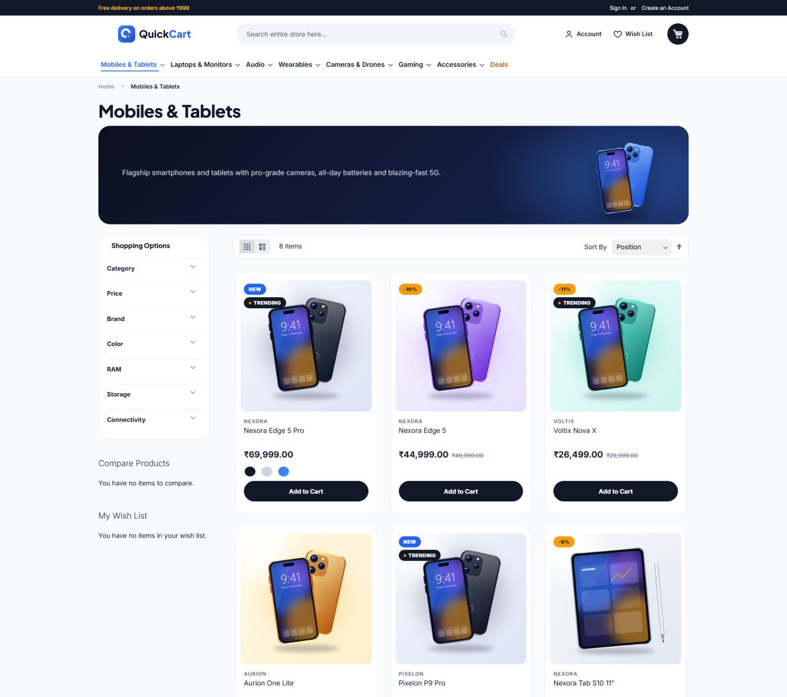

# QuickCart — Magento 2 eCommerce Platform

> **Shop Smarter. Shop Faster.**

QuickCart is a multi-category electronics store built on **Magento Open Source 2.4.9**.
It is a portfolio project that shows real-world Magento development: custom modules
built on service contracts, a custom Luma-based theme with Motion animations,
declarative schema, data patches, REST APIs, admin tooling and performance tuning.
It changes no Magento core files.


| Status | Phase |
| :----: | ----- |
| ✅ | **Phase 1:** Magento installation & native Windows dev stack |
| ✅ | **Phase 2:** QuickCart branding, logo & responsive theme with Motion animations |
| ✅ | **Phase 3:** Homepage, catalog attributes, layered navigation, 48 demo products |
| ⏳ | Phase 4: Product & checkout enhancements (reviews, cross-sells, checkout UI) |
| ⏳ | Phase 5: Custom modules (labels admin, recommendations, order tracking, checkout) |
| ⏳ | Phase 6: REST API (`QuickCart_CustomApi`) |
| ⏳ | Phase 7: Admin sales dashboard, grids, ACL |
| ⏳ | Phase 8: Testing, optimization & final documentation |

---

## Features built so far

**Storefront (theme `QuickCart/default`, Luma child)**
- Brand identity: SVG logo (wordmark converted to outlines), favicon, brand palette
  (#2563EB, #111827, #F59E0B, #F8FAFC), self-hosted Inter and Plus Jakarta Sans fonts.
- Glass sticky header (the promo bar scrolls away, so there's no layout shift), pill search,
  account and wish list shortcuts, and an animated underline mega menu.
- Homepage built from editable CMS blocks and widgets: hero slider, trust bar, category
  tiles, product rails (trending, deals, new arrivals, best sellers), promo banners and
  a brand marquee.
- Product cards with real-data badges (sale %, New, Trending), brand line, swatches,
  wish list and compare.
- Category banner, layered navigation (brand, color swatch, RAM, storage, connectivity,
  price), and a product page with brand, badges, swatches and delivery and returns
  assurances.
- Responsive from 360 px to 1920 px+.

**Motion design** ([Motion](https://motion.dev), the framework-agnostic engine behind
Framer Motion, loaded through RequireJS):
- Hero slides choreographed (copy staggers out and in, product art springs in), with
  autoplay and a progress bar, swipe and keyboard control, and pointer parallax.
- Scroll reveals and staggered grids, 3D tilt with light glare, button press feedback, a
  fly-to-cart image arc, a cart badge bump and a reading progress bar on product pages.
- `prefers-reduced-motion` is respected. Content is server-rendered and visible without JS.

**Catalog (data patches, no manual setup)**
- 8 categories and 15 subcategories, 48 products (4 configurable products with 12 color
  variants), 21 deals, 17 trending, 12 new arrivals.
- Fictional brands (Voltix, Nexora, Aurion, Pixelon, Sonavo, Zentra, Orbix, Kairo) and
  original product illustrations, so there are no trademark or stock-photo concerns.
- Store settings that match the storefront copy: free delivery above ₹999, ₹79 flat
  rate, and cash on delivery.

| Category page | Product page | Mobile |
| --- | --- | --- |
|  |  |  |

---

## Technology stack

| Layer | Version | Notes |
| ----- | ------- | ----- |
| Magento Open Source | 2.4.9 | Composer project (`magento/project-community-edition`) |
| PHP | 8.4 (NTS x64) | 2.4.9 supports 8.3 – 8.5 |
| Composer | 2.11 | |
| MySQL | 8.4 LTS | |
| OpenSearch | 3.9 | Catalog search and layered navigation |
| Nginx | 1.30 | Uses Magento's own `nginx.conf.sample` rules |
| Frontend | LESS, Knockout.js, RequireJS, jQuery UI widgets | Magento Luma stack |
| Animation | Motion 14.7 (MIT) | Vendored in `web/js/vendor/motion.js` |

**Cache/session store:** local development uses Magento's file cache and its built-in
full-page cache, because Redis/Valkey publish no native Windows builds. On Linux,
deployments use Valkey/Redis for cache, page cache and sessions (Phase 8 documents
this).

---

## Repository layout

```
.
├── devstack/                   Native Windows development stack (no Docker, no admin rights)
│   ├── qc.cmd / qc.ps1         Developer CLI: install, start/stop, magento, composer, mysql
│   ├── .env.example            Versions, ports, credentials template (.env is git-ignored)
│   ├── lib/                    Stack + Magento installer logic, php-cgi supervisor
│   └── templates/              php.ini, my.ini, opensearch.yml, nginx.conf templates
├── src/                        Magento project root (only project-owned files are committed)
│   ├── composer.json / .lock
│   ├── app/code/QuickCart/     Custom modules
│   ├── app/design/frontend/QuickCart/default/   Theme
│   └── app/etc/config.php      Module list / shared deployment config
├── tools/design-assets/        Node build: product illustrations, logo, fixtures, vendored Motion + fonts
└── docs/                       Screenshots and phase notes
```

`src/vendor`, `generated`, `var`, `pub/static`, `pub/media`, `app/etc/env.php` and every
file that Composer deploys from `magento/magento2-base` are **not committed**: running
`composer install` recreates them. See [.gitignore](.gitignore).

### Runtime architecture (local)

```
Browser ──► Nginx :8080 ──FastCGI──► php-cgi ×3 (:9071-9073, supervised) ──► Magento 2.4.9
                                                                   │
                                          ┌────────────────────────┼─────────────────────┐
                                          ▼                        ▼                     ▼
                                   MySQL 8.4 :3307        OpenSearch 3.9 :9200    var/ file cache
```

All binaries, data and logs live in `STACK_DIR` (default `E:/quickcart-stack`), so the
stack doesn't touch other PHP/MySQL installs on the machine, such as XAMPP.

---

## Custom modules

| Module | Purpose |
| ------ | ------- |
| `QuickCart_CatalogEnhancement` | EAV attributes `qc_brand`, `qc_color` (visual swatch), `qc_ram`, `qc_storage`, `qc_display`, `qc_battery`, `qc_connectivity`, `qc_warranty` and `qc_is_trending`; the *QuickCart Electronics* attribute set; the **QuickCart Product Carousel** CMS widget, whose merchandising sources (trending, new, deals, best sellers) are a strategy pool in `di.xml`; the **QuickCart Category Tiles** widget; and the `ProductBadges` view model. Both widgets are block- and FPC-cache aware. |
| `QuickCart_DemoData` | Data patches that install attribute options and swatch colors, the category tree with images, 48 products (simple and configurable, through `ProductRepositoryInterface`), homepage CMS blocks and page, shipping and payment settings, and the theme assignment. Content lives in `fixtures/`, generated by `tools/design-assets`. |
| `QuickCart_WindowsCompat` | Native-Windows adapters with no core edits, each a no-op on Linux: template path validation, the GD2 adapter with drive paths, static-file theme lookup (`pub/static.php`), product image URLs, gallery file names, Copy instead of Symlink materialization, and a data patch that repairs stored paths. Unit-tested. |
| `QuickCart_ProductRecommendation` | Phase 5: frequently bought together, recently viewed, related recommendations |
| `QuickCart_OrderTracking` | Phase 5: shipment tracking, custom status display, customer tracking page |
| `QuickCart_CheckoutEnhancement` | Phase 4/5: checkout UI improvements, custom fields, extra validation |
| `QuickCart_SalesDashboard` | Phase 7: sales analytics, revenue and best-seller reports |
| `QuickCart_CustomApi` | Phase 6: REST endpoints for products, categories, orders, customers |

The **Best sellers** rail reads Magento's sales report aggregation, so it stays hidden
until there are orders. Run *Reports › Refresh Statistics* after placing orders.

---

## Installation (Windows 10/11, native)

**Requirements:** Windows 10/11 x64, Git, about 6 GB free disk for `STACK_DIR`, 8 GB+ RAM, and the
Microsoft Visual C++ 2015-2022 x64 runtime (needed by PHP).

```bat
git clone <repo-url> quickcart
cd quickcart

:: 1. Download + configure PHP, Composer, MySQL, OpenSearch, Nginx into STACK_DIR
devstack\qc install-stack

:: 2. composer install, then bin/magento setup:install (runs every data patch: catalog,
::    CMS, theme), reindex, and pre-generates all product image sizes
devstack\qc install-magento
```

The first run of `install-stack` creates `devstack/.env` and fills every empty
`*_PASSWORD` with a random secret. Keep this file local; it is git-ignored.

| URL | |
| --- | --- |
| Storefront | http://quickcart.localhost:8080/ |
| Admin | http://quickcart.localhost:8080/qc_admin — user `qcadmin`, password = `ADMIN_PASSWORD` in `devstack/.env` |

`*.localhost` resolves to `127.0.0.1` in Chrome, Edge and Firefox, so you don't need to
edit the hosts file.

### Daily use

```bat
devstack\qc start                  :: MySQL, OpenSearch, PHP-CGI workers, Nginx
devstack\qc status                 :: service health + storefront/admin HTTP codes
devstack\qc stop

devstack\qc clean-static           :: after editing the theme (LESS/JS/templates)
devstack\qc magento cache:flush    :: any bin/magento command
devstack\qc magento setup:upgrade
devstack\qc composer show magento/framework
devstack\qc mysql                  :: MySQL client on the quickcart database
```

### Regenerating design assets

The illustrations, logo, catalog fixtures and vendored Motion/fonts are committed, so
installs need no Node. To change them, edit `tools/design-assets/catalog.mjs` or
`lib/devices.mjs` and run:

```bat
cd tools\design-assets
npm install
npm run build
```

### Database setup

`install-stack` initializes MySQL 8.4 with its own data directory (`STACK_DIR/data/mysql`)
and creates:

* database `quickcart` (`utf8mb4`),
* user `quickcart@127.0.0.1` with privileges on `quickcart.*` only, which Magento uses
  through `app/etc/env.php`,
* a root password used only by the CLI (`STACK_DIR/conf/mysql-root.cnf`).

Magento then creates its schema with `setup:install`. Custom tables are always added
with declarative schema (`etc/db_schema.xml`) plus data/schema patches, never through
direct changes to core tables.

### Using Adobe's Composer repository instead of the mirror

By default, packages come from `https://mirror.mage-os.org/`, a public mirror of the
Magento Open Source packages that needs no keys. To use Adobe's repository instead:
set `MAGENTO_COMPOSER_REPO=https://repo.magento.com/` in `devstack/.env`, run
`devstack\qc composer config repositories.magento composer https://repo.magento.com/`,
and put your Commerce Marketplace keys in `src/auth.json` (git-ignored).

### Local-only settings

`install-magento` applies these for development only. Revert them in any shared or
production environment:

* Admin 2FA modules (`Magento_TwoFactorAuth`, `Magento_AdminAdobeImsTwoFactorAuth`) are
  disabled, because 2FA needs a mail server or authenticator setup.
* Email sending is off (`system/smtp/disable = 1`), because there is no local mail server.
* OpenSearch runs on loopback with its security plugin disabled.
* Deploy mode is `developer`.
* `system/media_storage_configuration/configuration_update_time = 0`: on Windows,
  `pub/get.php`'s cached fast path mis-compares paths, so the full media app is always used.

---

## API documentation

REST endpoints and a Postman collection will be documented here in Phase 6.

## License

Proprietary. Portfolio project. Magento Open Source is licensed under OSL-3.0 / AFL-3.0.
Motion is MIT licensed; Inter and Plus Jakarta Sans are SIL OFL 1.1 (license files ship
next to the vendored assets).
