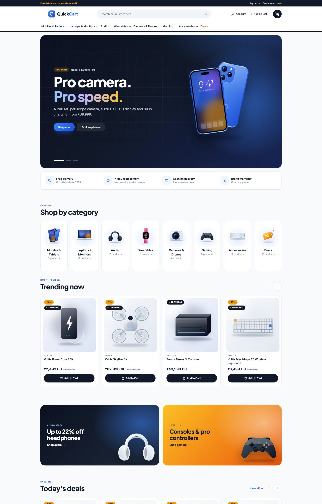
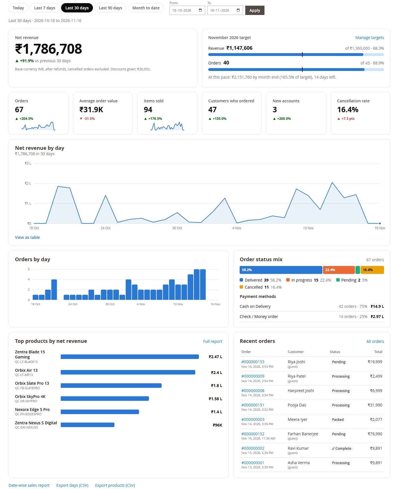
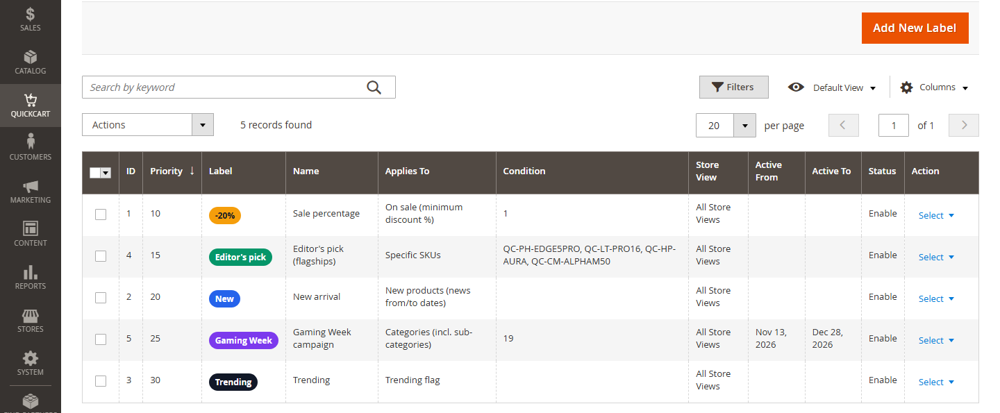
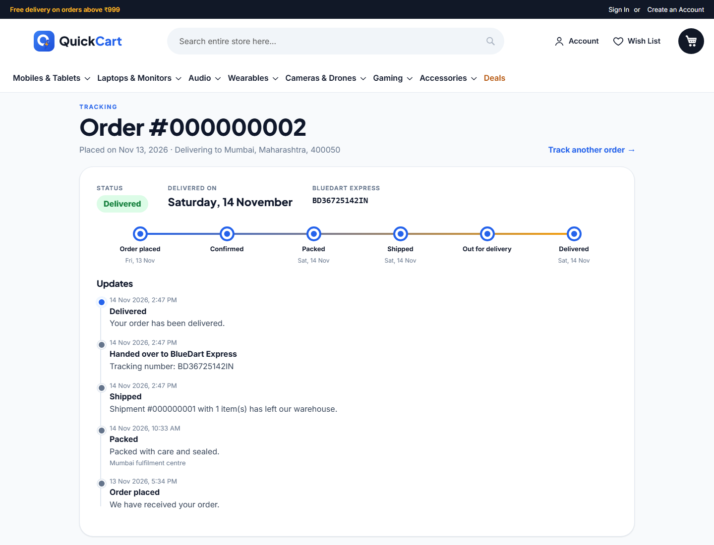
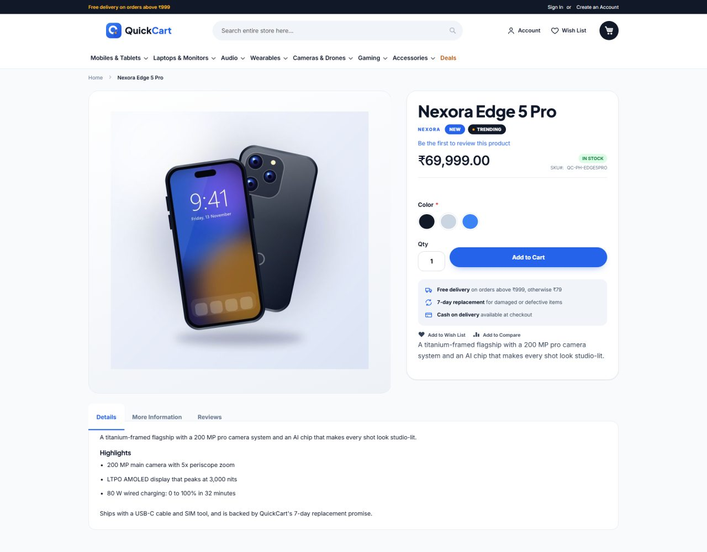
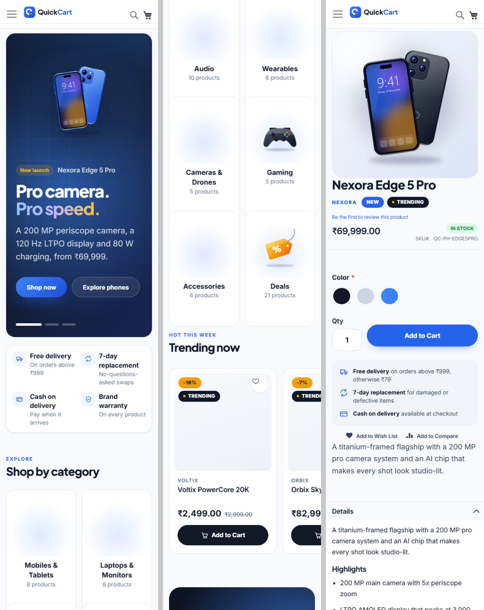

# QuickCart — Magento 2 eCommerce Platform

> **Shop Smarter. Shop Faster.**

QuickCart is a multi-category electronics store built on **Magento Open Source 2.4.9**.
It is a portfolio project that shows real-world Magento development: custom modules
built on service contracts, a custom Luma-based theme with Motion animations,
declarative schema, data patches, REST APIs, admin tooling and performance tuning.
It changes no Magento core files.



| Status | Phase |
| :----: | ----- |
| ✅ | **Phase 1:** Magento installation & native Windows dev stack |
| ✅ | **Phase 2:** QuickCart branding, logo & responsive theme with Motion animations |
| ✅ | **Phase 3:** Homepage, catalog attributes, layered navigation, 48 demo products |
| ✅ | **Phase 4:** Reviews & ratings, related/up-sell/cross-sell, coupons, free-delivery meter, checkout fields + Indian validation |
| ✅ | **Phase 5:** Custom modules: product labels admin, recommendations (bought together, similar, recently viewed), order tracking, checkout settings |
| ✅ | **Phase 6:** REST API (`QuickCart_CustomApi`): products, categories, orders, customers and a Postman collection |
| ✅ | **Phase 7:** Admin sales dashboard (KPIs, revenue/orders charts, status mix, top products, targets), date-wise & best-seller reports with CSV export, demo order history generator |
| ✅ | **Phase 8:** 156 unit tests, REST smoke test, PHPCS-clean, DI compilation checked, performance & security notes, [deployment guide](docs/deployment.md) |

---

## Features

**Storefront (theme `QuickCart/default`, Luma child)**
- Brand identity: SVG logo (wordmark converted to outlines), favicon, brand palette
  (#2563EB, #111827, #F59E0B, #F8FAFC), self-hosted Inter and Plus Jakarta Sans fonts.
- Glass sticky header (the promo bar scrolls away, so there's no layout shift), pill search,
  account and wish list shortcuts, and an animated underline mega menu.
- Homepage built from editable CMS blocks and widgets: hero slider, trust bar, category
  tiles, product rails (trending, deals, new arrivals, best sellers), promo banners and
  a brand marquee.
- Product cards with real-data badges (sale %, New, Trending), brand line, swatches,
  wish list and compare.
- Category banner, layered navigation (brand, color swatch, RAM, storage, connectivity,
  price), and a product page with brand, badges, swatches and delivery and returns
  assurances.
- Responsive from 360 px to 1920 px+.

**Motion design** ([Motion](https://motion.dev), the framework-agnostic engine behind
Framer Motion, loaded through RequireJS):
- Hero slides choreographed (copy staggers out and in, product art springs in), with
  autoplay and a progress bar, swipe and keyboard control, and pointer parallax.
- Scroll reveals and staggered grids, 3D tilt with light glare, button press feedback, a
  fly-to-cart image arc, a cart badge bump and a reading progress bar on product pages.
- `prefers-reduced-motion` is respected. Content is server-rendered and visible without JS.

**Catalog (data patches, no manual setup)**
- 8 categories and 15 subcategories, 48 products (4 configurable products with 12 color
  variants), 21 deals, 17 trending, 12 new arrivals.
- Fictional brands (Voltix, Nexora, Aurion, Pixelon, Sonavo, Zentra, Orbix, Kairo) and
  original product illustrations, so there are no trademark or stock-photo concerns.
- Store settings that match the storefront copy: free delivery above ₹999, ₹79 flat
  rate, and cash on delivery.

**Product, cart & checkout (Phase 4)**
- 5-star "Rating" with 150 demo reviews; stars on every product card, review list and form on
  the product page.
- Related ("Pairs well with"), up-sell ("Upgrade your pick") and cart cross-sell ("Complete
  your setup") links for every product.
- Coupons as real cart price rules: `QUICK10` (10% off) and `WELCOME500` (₹500 off orders of
  ₹4,999+), with an "Available offers" card that applies them in one click.
- A free-delivery progress meter in the mini cart and the cart, from the cart's private
  customer-data section, so it stays correct on fully cached pages.
- Checkout "Delivery details": delivery instructions and GSTIN for business invoices. They're
  stored in their own table, exposed as order extension attributes (REST `/V1/orders`), and
  shown on the success page, the customer order view and the admin order view.
- Indian mobile number, PIN code and GSTIN validation in the browser and on the server, so
  REST and guest checkouts are covered too.
- India as the default country, cash on delivery, and styled cart, checkout and
  success pages.

**Custom modules & admin (Phase 5)**
- **QuickCart admin menu** with ACL for every screen and action, and a *QuickCart* tab in
  Stores › Configuration (Catalog & Labels, Recommendations, Order Tracking, Checkout).
- **Product labels:** an admin grid and form (UI components: filters, mass enable, disable and
  delete, colour pickers, store views, date ranges). Rules target specific SKUs, categories
  including their sub-categories, discounts of N% or more ("-{discount}%"), new products or
  trending products, and are shown in priority order on every product card and the product
  page. Default Sale / New / Trending rules plus a demo "Editor's pick" (SKUs) and a dated
  "Gaming Week" category campaign.
- **Frequently bought together** on the product page, mined from real order co-purchases and
  topped up with cross-sells. It has checkboxes, a live bundle total, and "Add all to cart"
  through Magento's native `related_product` add-to-cart, so options and validation still
  apply.
- **More like this** rail, scored from catalog data (shared leaf category, brand and price
  band), and **Recently viewed** (history in the shopper's localStorage, rendered over AJAX, so
  pages stay fully cached) on the product page, cart and homepage.
- **Recommendations admin grid:** auto (orders / catalog) and manual rows, with Show / Hide,
  "Rebuild Now", a nightly cron and `bin/magento quickcart:recommendations:rebuild`.
- **Order tracking:** custom order statuses (*Packed*, *Shipped*, *Out for Delivery*) and a
  tracking timeline. Status changes, shipments and carrier tracking numbers are recorded
  automatically by observers; admins add updates (with location and an optional status
  change) from a *Tracking* tab on the order view.
- **Customer tracking page** `/track`: order number plus email or mobile number, rate limited,
  showing a progress stepper, estimated delivery (business days), courier, tracking number
  and updates. The same timeline appears on *My Account › My Orders*.

**Sales analytics (Phase 7)**: see `QuickCart_SalesDashboard` below.



| Product labels (admin) | Order tracking page |
| --- | --- |
|  |  |

| Category page | Product page | Mobile |
| --- | --- | --- |
|  |  |  |

---

## Technology stack

| Layer | Version | Notes |
| ----- | ------- | ----- |
| Magento Open Source | 2.4.9 | Composer project (`magento/project-community-edition`) |
| PHP | 8.4 (NTS x64) | 2.4.9 supports 8.3 – 8.5 |
| Composer | 2.11 | |
| MySQL | 8.4 LTS | |
| OpenSearch | 3.9 | Catalog search and layered navigation |
| Nginx | 1.30 | Uses Magento's own `nginx.conf.sample` rules |
| Frontend | LESS, Knockout.js, RequireJS, jQuery UI widgets | Magento Luma stack |
| Animation | Motion 14.7 (MIT) | Vendored in `web/js/vendor/motion.js` |

**Cache/session store:** local development uses Magento's file cache and its built-in
full-page cache, because Redis/Valkey publish no native Windows builds. Production on
Linux uses Valkey/Redis for cache, page cache and sessions, with optional Varnish; see
[docs/deployment.md](docs/deployment.md).

---

## Repository layout

```
.
├── devstack/                   Native Windows development stack (no Docker, no admin rights)
│   ├── qc.cmd / qc.ps1         Developer CLI: install, start/stop, magento, composer, mysql
│   ├── .env.example            Versions, ports, credentials template (.env is git-ignored)
│   ├── lib/                    Stack + Magento installer logic, php-cgi supervisor
│   └── templates/              php.ini, my.ini, opensearch.yml, nginx.conf templates
├── src/                        Magento project root (only project-owned files are committed)
│   ├── composer.json / .lock
│   ├── app/code/QuickCart/     Custom modules
│   ├── app/design/frontend/QuickCart/default/   Theme
│   └── app/etc/config.php      Module list / shared deployment config
├── tools/design-assets/        Node build: product illustrations, logo, fixtures, vendored Motion + fonts
├── tools/qa/api-smoke.mjs      REST API smoke test (no dependencies)
└── docs/                       Screenshots, deployment.md (production guide), postman/ (API collection)
```

`src/vendor`, `generated`, `var`, `pub/static`, `pub/media`, `app/etc/env.php` and every
file that Composer deploys from `magento/magento2-base` are **not committed**: running
`composer install` recreates them. See [.gitignore](.gitignore).

### Runtime architecture (local)

```
Browser ──► Nginx :8080 ──FastCGI──► php-cgi ×3 (:9071-9073, supervised) ──► Magento 2.4.9
                                                                   │
                                          ┌────────────────────────┼─────────────────────┐
                                          ▼                        ▼                     ▼
                                   MySQL 8.4 :3307        OpenSearch 3.9 :9200    var/ file cache
```

All binaries, data and logs live in `STACK_DIR` (default `E:/quickcart-stack`), so the
stack doesn't touch other PHP/MySQL installs on the machine, such as XAMPP.

---

## Custom modules

| Module | Purpose |
| ------ | ------- |
| `QuickCart_CatalogEnhancement` | EAV attributes `qc_brand`, `qc_color` (visual swatch), `qc_ram`, `qc_storage`, `qc_display`, `qc_battery`, `qc_connectivity`, `qc_warranty` and `qc_is_trending`; the *QuickCart Electronics* attribute set; the **QuickCart Product Carousel** CMS widget, whose merchandising sources (trending, new, deals, best sellers) are a strategy pool in `di.xml`; the **QuickCart Category Tiles** widget; and the `ProductBadges` view model. Both widgets are block- and FPC-cache aware. |
| `QuickCart_DemoData` | Data patches that install attribute options and swatch colors, the category tree with images, 48 products (simple and configurable, through `ProductRepositoryInterface`), reviews and ratings, product links (`ProductLinkManagementInterface`), coupon rules (SalesRule repositories), homepage and cart CMS content, shipping, payment and India settings, and the theme assignment. Content lives in `fixtures/`, generated by `tools/design-assets`. |
| `QuickCart_WindowsCompat` | Native-Windows adapters with no core edits, each a no-op on Linux: template path validation, the GD2 adapter with drive paths, static-file theme lookup (`pub/static.php`), product image URLs, gallery file names, Copy instead of Symlink materialization, and a data patch that repairs stored paths. Unit-tested. |
| `QuickCart_Core` | Admin shell shared by the feature modules: the *QuickCart* menu, the ACL root, the configuration tab, and reusable UI-component buttons (Back, Delete, Save, Save and Continue), a row-actions column and store-view options. |
| `QuickCart_ProductRecommendation` | `quickcart_product_recommendation` table (FKs to products, unique per pair and type) behind `RecommendationRepositoryInterface`. `BoughtTogetherBuilder` mines `sales_order_item` co-purchases and `SimilarProductsBuilder` scores catalog similarity; `Rebuilder` swaps the automatic rows in one transaction and cleans cache tags (cron, CLI, admin). Storefront: the *Frequently bought together* block, the *More like this* rail (reusing the carousel widget through `ProductRail`), and *Recently viewed* (localStorage plus `GET qcreco/recent/render`). Admin grid and form with mass actions. Unit-tested. |
| `QuickCart_OrderTracking` | `quickcart_order_tracking_event` table (FK to `sales_order`, unique per order and reference) behind `TrackingEventRepositoryInterface`. Data patches add three custom order statuses and backfill existing orders. Observers on order, shipment and track saves record forward-only milestones. Admin: an order view tab, an updates grid and settings. Storefront: `/track` lookup (CSRF form key, session rate limit, email or phone match), a non-cached tracking page, and a timeline on the customer order page. Unit-tested. |
| `QuickCart_CheckoutEnhancement` | `quickcart_checkout_meta` table (declarative schema, FKs to `quote` with SET NULL and `sales_order` with CASCADE, unique keys) behind `CheckoutMetaRepositoryInterface`. A plugin on `ShippingInformationManagementInterface` validates and saves, an observer links the record to the order, and an `OrderRepository` plugin adds the extension attributes. Also: a `LayoutProcessor` plugin and JS mixins (payload extender, shipping validation, validator rules), the free-delivery customer-data plugin and Knockout component, and order view templates for the storefront and admin. Each field, the Indian address rules and the free-delivery meter can be switched off in Stores › Configuration › QuickCart › Checkout. Unit-tested. |
| `QuickCart_SalesDashboard` | Admin › QuickCart › Sales Analytics. The **dashboard** shows net revenue with period-over-period change, six KPI tiles with sparklines, a revenue-by-day line (crosshair tooltip and table view), orders-by-day columns, order status mix, payment methods, top products, recent orders and monthly target progress. Charts are server-rendered SVG (no chart library) using a colour-blind-validated palette. **Reports:** date-wise sales and best-selling products for any range, with CSV export (formula-injection safe). **Sales targets:** `quickcart_sales_target` table with an admin CRUD grid. Live indexed queries on the sales tables; ACL per screen. `bin/magento quickcart:demo:orders` (QuickCart_DemoData) generates a realistic, reproducible order history through Magento's own order, invoice, shipment and cancel services. |
| `QuickCart_CustomApi` | 12 REST endpoints (see [API documentation](#api-documentation)) built as service contracts with 17 typed data interfaces. Product cards reuse the storefront's label rules, prices, review summaries and URL rewrites through one bulk-loaded collection; category counts come from the category product index. Order endpoints share `TimelineBuilder` and `TrackingUpdater` with QuickCart_OrderTracking; guest tracking is rate limited per IP in the cache. ACL resources for the admin endpoints. Unit-tested. |

The **Best sellers** rail reads Magento's sales report aggregation, so it stays hidden
until there are orders. Run *Reports › Refresh Statistics* after placing orders.

---

## Installation (Windows 10/11, native)

**Requirements:** Windows 10/11 x64, Git, about 6 GB free disk for `STACK_DIR`, 8 GB+ RAM, and the
Microsoft Visual C++ 2015-2022 x64 runtime (needed by PHP).

```bat
git clone <repo-url> quickcart
cd quickcart

:: 1. Download + configure PHP, Composer, MySQL, OpenSearch, Nginx into STACK_DIR
devstack\qc install-stack

:: 2. composer install, then bin/magento setup:install (runs every data patch: catalog,
::    CMS, theme), reindex, and pre-generates all product image sizes
devstack\qc install-magento
```

The first run of `install-stack` creates `devstack/.env` and fills every empty
`*_PASSWORD` with a random secret. Keep this file local; it is git-ignored.

| URL | |
| --- | --- |
| Storefront | http://quickcart.localhost:8080/ |
| Admin | http://quickcart.localhost:8080/qc_admin — user `qcadmin`, password = `ADMIN_PASSWORD` in `devstack/.env` |

`*.localhost` resolves to `127.0.0.1` in Chrome, Edge and Firefox, so you don't need to
edit the hosts file.

### Daily use

```bat
devstack\qc start                  :: MySQL, OpenSearch, PHP-CGI workers, Nginx
devstack\qc status                 :: service health + storefront/admin HTTP codes
devstack\qc stop

devstack\qc share                  :: public https link (Cloudflare quick tunnel), admin stays local
devstack\qc unshare                :: stop sharing, restore the local URLs
devstack\qc clean-static           :: after editing the theme (LESS/JS/templates)
devstack\qc magento cache:flush    :: any bin/magento command
devstack\qc magento setup:upgrade
devstack\qc composer show magento/framework
devstack\qc mysql                  :: MySQL client on the quickcart database

devstack\qc magento quickcart:recommendations:rebuild   :: recompute bought-together + similar products
```

### Testing and code quality

| Check | Command | Status |
| ----- | ------- | ------ |
| Unit tests (PHPUnit 12, 156 tests) | `cd src\dev\tests\unit` then `..\..\..\..\devstack\qc php ../../../vendor/bin/phpunit -c phpunit.xml.dist ../../../app/code/QuickCart` | all pass |
| Coding standard (Magento2, severity 7) | `cd src` then `..\devstack\qc php vendor/bin/phpcs --standard=Magento2 --extensions=php --severity=7 app/code/QuickCart` | 0 errors, 0 warnings |
| REST API smoke test (22 checks) | `node tools/qa/api-smoke.mjs` (set `QC_ADMIN_USER` / `QC_ADMIN_PASSWORD` for the admin endpoints) | all pass |
| Production DI compilation | `bin/magento setup:di:compile` (on Linux, see [deployment](docs/deployment.md)) | On Windows, 8 of 9 steps pass (code generation, all interceptors, area configuration). The last step fails in Magento core, which writes a file named `primary\|global\|plugin-list.php`, and `\|` is not allowed in Windows file names. Run the full compile on Linux. |

The unit tests cover the logic that decides outcomes:
- label matching and validation;
- recommendation ranking and similarity scoring;
- order-tracking milestones, estimated delivery and contact matching;
- tracking updates and status rules;
- API input sanitising (sorting, paging, LIKE escaping, date ranges, rate limiting);
- dashboard periods, chart geometry, money formatting, formula-safe CSV and target
  validation;
- checkout validation and the Windows adapters.

Each phase was also verified end to end in a real browser, through headless Chrome
scripts: checkout, the bought-together add-to-cart, recently viewed, `/track`, every admin
grid and form, and the dashboard tooltips.

### Performance and security in the code

- **Caching:**
  - Storefront pages stay fully cacheable. Per-visitor parts (recently viewed, free-delivery
    meter) load from localStorage, customer-data sections or AJAX.
  - Widgets are block-cached and carry product cache tags.
  - Saving a label or rebuilding recommendations cleans only the affected cache tags.
- **Queries:**
  - Product lists batch-load prices, review summaries, URL rewrites and label data.
  - Dashboard and report figures are a handful of grouped queries on indexed columns
    (`sales_order.created_at`).
  - Recommendations are precomputed nightly instead of being worked out per page view.
- **Security:**
  - ACL on every admin screen and API endpoint; admin URL secret keys stay on.
  - CSRF form keys on every POST; all template output is escaped.
  - Typed, validated input with prepared SQL; LIKE wildcards are escaped.
  - Guest order lookups are rate limited and reveal no address or payment data.
  - CSV exports are protected against formula injection.
  - Customer API routes take the customer ID from the token only.
- **Production setup:** see [docs/deployment.md](docs/deployment.md) for production mode,
  OPcache, Valkey/Redis, Varnish, cron, indexers on schedule, TLS, 2FA and a hardening
  checklist.

### Regenerating design assets

The illustrations, logo, catalog fixtures and vendored Motion/fonts are committed, so
installs need no Node. To change them, edit `tools/design-assets/catalog.mjs` or
`lib/devices.mjs` and run:

```bat
cd tools\design-assets
npm install
npm run build
```

### Database setup

`install-stack` initializes MySQL 8.4 with its own data directory (`STACK_DIR/data/mysql`)
and creates:

* database `quickcart` (`utf8mb4`),
* user `quickcart@127.0.0.1` with privileges on `quickcart.*` only, which Magento uses
  through `app/etc/env.php`,
* a root password used only by the CLI (`STACK_DIR/conf/mysql-root.cnf`).

Magento then creates its schema with `setup:install`. Custom tables are always added
with declarative schema (`etc/db_schema.xml`) plus data/schema patches, never through
direct changes to core tables.

### Using Adobe's Composer repository instead of the mirror

By default, packages come from `https://mirror.mage-os.org/`, a public mirror of the
Magento Open Source packages that needs no keys. To use Adobe's repository instead:
set `MAGENTO_COMPOSER_REPO=https://repo.magento.com/` in `devstack/.env`, run
`devstack\qc composer config repositories.magento composer https://repo.magento.com/`,
and put your Commerce Marketplace keys in `src/auth.json` (git-ignored).

### Local-only settings

`install-magento` applies these for development only. Revert them in any shared or
production environment:

* Admin 2FA modules (`Magento_TwoFactorAuth`, `Magento_AdminAdobeImsTwoFactorAuth`) are
  disabled, because 2FA needs a mail server or authenticator setup.
* Email sending is off (`system/smtp/disable = 1`), because there is no local mail server.
* OpenSearch runs on loopback with its security plugin disabled.
* Deploy mode is `developer`.
* `system/media_storage_configuration/configuration_update_time = 0`: on Windows,
  `pub/get.php`'s cached fast path mis-compares paths, so the full media app is always used.

---

## API documentation

`QuickCart_CustomApi` adds storefront-ready REST endpoints under
`/rest/{store_code}/V1/quickcart/`. Each one is a service contract (`Api/*Interface`) with
typed data interfaces, so Magento's own Swagger schema documents the requests and responses at
`/rest/default/schema?services=all`. The schema lists only the endpoints the caller's token may
use: all 12 with an admin token. A ready-to-use Postman collection is in
[`docs/postman/QuickCart-REST-API.postman_collection.json`](docs/postman/QuickCart-REST-API.postman_collection.json).

| Method | Endpoint | Access | Purpose |
| ------ | -------- | ------ | ------- |
| GET | `/V1/quickcart/products` | anonymous | Product cards with filters (`categoryId`, `brand`, `priceFrom`, `priceTo`, `search`), sorting (`sortBy`: position, name, price, newest; `sortDir`) and paging (`page`, `pageSize` ≤ 48) |
| GET | `/V1/quickcart/products/:sku` | anonymous | Product page data: card, descriptions, specifications, gallery, configurable options, related / up-sell SKUs |
| GET | `/V1/quickcart/products/:sku/recommendations` | anonymous | Frequently bought together (salable companions) and similar products |
| GET | `/V1/quickcart/categories?depth=3` | anonymous | Category tree with URLs, images and visible product counts |
| GET | `/V1/quickcart/categories/:categoryId/products` | anonymous | Products of a category (same cards, sorting and paging) |
| POST | `/V1/quickcart/orders/track` | anonymous | Guest tracking by `orderNumber` + `contact` (email or mobile); rate limited per IP |
| GET | `/V1/quickcart/customers/me` | customer token | Own profile: group, default delivery area, orders, lifetime value, wish list |
| GET | `/V1/quickcart/customers/me/orders` | customer token | Own orders, newest first, with tracking milestone |
| GET | `/V1/quickcart/customers/me/orders/:orderNumber/tracking` | customer token | Own order tracking: steps, updates, courier, estimated delivery |
| GET | `/V1/quickcart/orders/stats?from=&to=` | admin: `QuickCart_CustomApi::order_stats` | Orders, revenue, AOV and status breakdown (default last 30 days, max 366) |
| POST | `/V1/quickcart/orders/:orderId/tracking` | admin: `QuickCart_OrderTracking::tracking_save` | Add a tracking update, optionally moving the order status |
| GET | `/V1/quickcart/customers/:customerId/profile` | admin: `QuickCart_CustomApi::customer_profiles` | Customer insights |

**Authentication.** Anonymous endpoints need no token. Customer endpoints take a bearer
token from `POST /V1/integration/customer/token`, and the customer ID is always taken from
the token, never from the request. Admin endpoints take an admin or integration token, and
the role needs the listed ACL resource (System › Permissions › User Roles › QuickCart ›
REST API).

```bash
# Cheapest Voltix products under ₹5,000
curl "http://quickcart.localhost:8080/rest/default/V1/quickcart/products?brand=Voltix&priceTo=5000&sortBy=price"

# Guest tracking
curl -X POST "http://quickcart.localhost:8080/rest/default/V1/quickcart/orders/track" \
     -H "Content-Type: application/json" \
     -d '{"orderNumber":"000000002","contact":"98200 12345"}'
```

```json
{
  "id": 58, "sku": "QC-AC-SILENT", "name": "Aurion Silent Mouse", "type": "simple",
  "url": "http://quickcart.localhost:8080/aurion-silent-mouse.html",
  "image_url": "http://quickcart.localhost:8080/media/catalog/product/q/c/qc-ac-silent_1.jpg",
  "brand": "Aurion", "price": 1299, "final_price": 999, "discount_percent": 23, "currency": "INR",
  "rating_percent": 80, "review_count": 3, "is_in_stock": true,
  "labels": [{ "code": "sale", "text": "-23%", "background_color": "#F59E0B", "text_color": "#111827" }]
}
```

**Errors** use Magento's REST format, `{"message": "Unknown brand \"%1\".", "parameters": ["Nokia"]}`:
400 for invalid input, 401 for a missing or insufficient token, 404 when something is not
found, and 429 after 10 failed guest tracking lookups from one IP in 15 minutes.

**Data exposure.** Anonymous endpoints only return enabled products of the store's website
that are visible in the catalog (or in search, for `search`). Hidden configurable children
and disabled products return 404. Guest tracking needs both the order number and the
checkout email or phone, returns delivery data only (no address or payment details), and
gives the same 404 for "wrong number" and "wrong contact".

## License

Proprietary. Portfolio project. Magento Open Source is licensed under OSL-3.0 / AFL-3.0.
Motion is MIT licensed; Inter and Plus Jakarta Sans are SIL OFL 1.1 (license files ship
next to the vendored assets).
